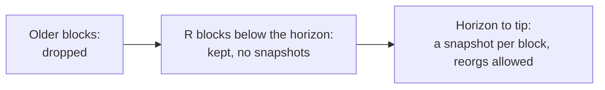
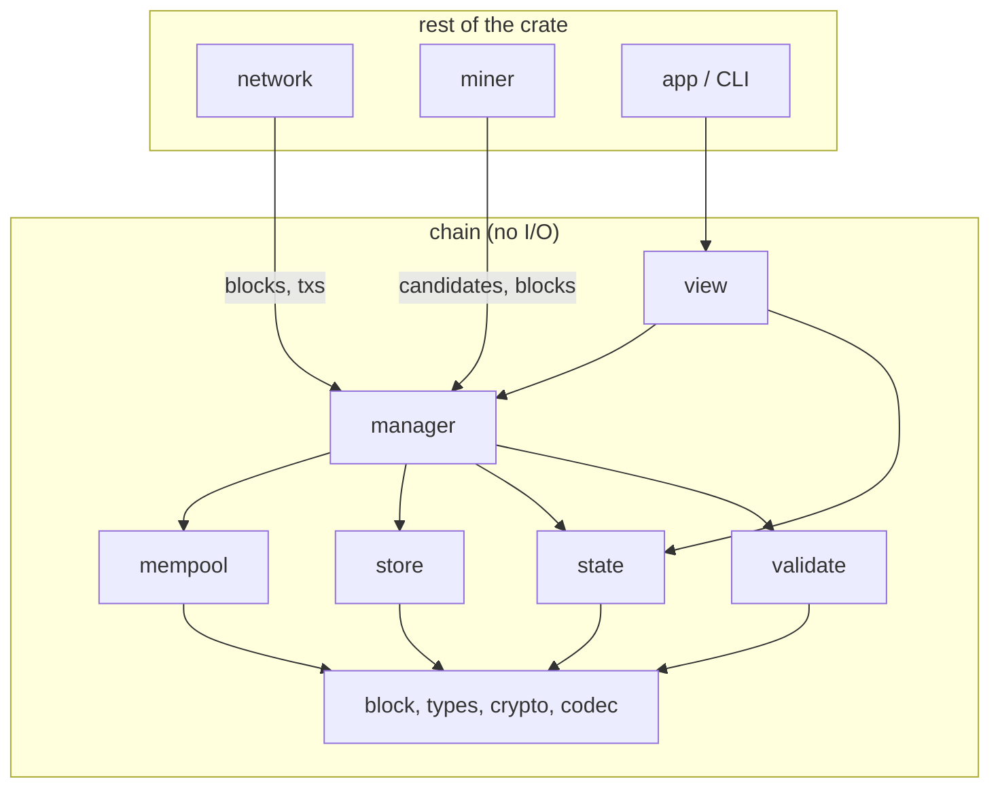
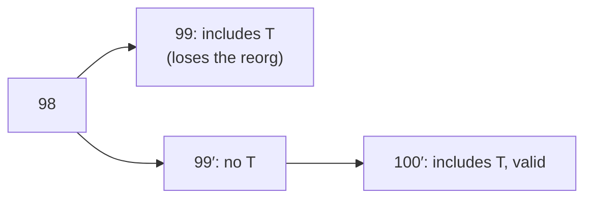
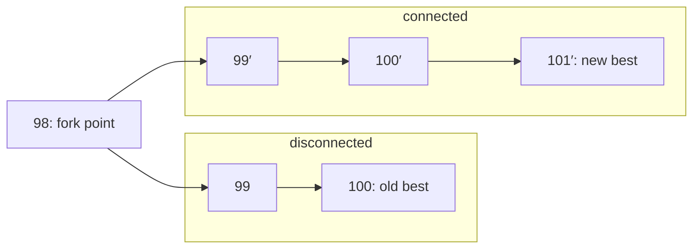
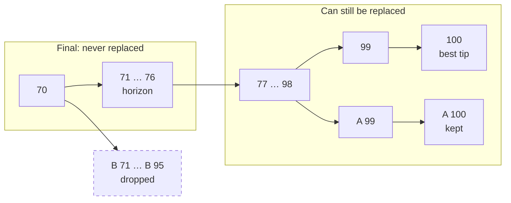
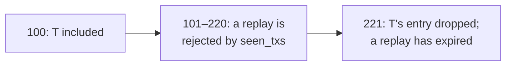
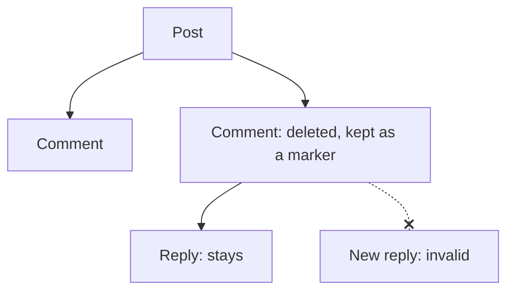
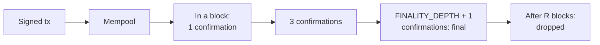

# Design

How a socialchain node works. The reasons behind these choices are in [decisions.md](decisions.md).

## 1. Overview

Terms used throughout:

- **Tip:** a block with no children yet. Each fork has one.
- **Best chain:** the chain ending at the tip with the most total work. On a tie, the tip seen first.
- **Fork point:** the last block two chains have in common.
- **Reorg:** switching the best chain to a different fork because it now has more work. For example, two miners both find block 101, and the next block lands on the one this node wasn't following.
- **Finality horizon:** `best.height − FINALITY_DEPTH`. The node never reorgs to a fork whose fork point is below it.
- **`R`:** how many blocks a post and its thread live (§8).

How it fits together:

- Each block from the horizon up has its own snapshot of the state (posts, comments, threads). Snapshots share structure, so each one only costs what its block changed.
- A reorg changes which snapshot is current. Nothing is undone or replayed.
- Below the horizon, snapshots are dropped. Blocks are kept `R` further down, so a new node can rebuild the horizon's state from them.
- Bodies are inside transactions. A delete marks a post or comment as deleted; its bytes stay until the block is dropped.
- Validation only reads memory, never disk or the network.
- A read picks how many confirmations it needs (`min_conf`, §9).



Protocol constants, which every node must agree on:

| Name | Value | Meaning |
|---|---|---|
| Difficulty | Fixed | No retargeting yet, so the real block interval drifts with hashrate |
| Block interval | 30 s | Expected time between blocks at the fixed difficulty |
| `MAX_BLOCK_BYTES` | 128 KB (131,072 bytes) | Largest serialized block |
| `MAX_BODY_BYTES` | 1,024 bytes, provisional | Largest post or comment body, in UTF-8 bytes ([decisions](decisions.md#open)) |
| `R` | 20,160 blocks (7 days) | How long a post and its thread live |
| `TX_TTL` | 120 blocks (1 h), provisional | Longest a tx stays valid |
| `FINALITY_DEPTH` | 24 blocks (12 min), provisional | Deepest reorg a node will follow |

Node limits, which peers don't need to agree on: `MAX_TIPS` = 64 forks tracked at once, the mempool byte cap (§7) and the orphan caps (§4).

Key crates: `imbl` (persistent maps, so snapshots share structure) and `primitive-types` (U256 work). The node adds `tokio`, plus a crate for its client API once Phase 3 picks one (JSON-RPC with `jsonrpsee` is the current idea).

## 2. Modules



`chain` holds consensus and state and does no networking or disk access, which keeps it easy to test. Everything else sits outside it. Dependencies only point down.

```
src/
  main.rs
  network.rs        gossip and block sync
  miner.rs
  chain/
    mod.rs
    types.rs        BlockId, TxId, PostId, CommentId, AccountId
    crypto.rs       SHA-256, Ed25519 verification
    codec.rs        canonical bincode
    block.rs        BlockHeader, Block, Tx, TxPayload
    store.rs        BlockStore: block tree, tips, orphans, invalid IDs
    state.rs        ChainState, apply_block
    validate.rs     checks that need no state (§4 steps 2, 5, 6)
    manager.rs      ChainManager: fork choice, reorg, pruning, block building
    mempool.rs      pending txs
    view.rs         read API
```

Signing and key generation live with the app; `chain` only verifies.

## 3. Data

### IDs

All IDs are 32 bytes.

| ID | What it is |
|---|---|
| `BlockId` | SHA-256 of the serialized header |
| `TxId` | SHA-256 of the bytes the author signed |
| `PostId`, `CommentId` | The `TxId` of the tx that created it |
| `AccountId` | The author's Ed25519 public key |

### Blocks

```rust
pub struct BlockHeader {
    pub parent:     BlockId,
    pub height:     u64,
    pub timestamp:  u64,
    pub tx_root:    Hash,         // merkle root over txs, bodies included
    pub difficulty: NonZeroU64,   // fixed for now
    pub nonce:      u64,
}

pub struct Block {
    pub header: BlockHeader,
    pub txs:    Vec<Tx>,
}

pub struct Tx {
    pub author:             AccountId,
    pub valid_until_height: u64,   // at most TX_TTL above the block that includes it
    pub payload:            TxPayload,
    pub signature:          Signature,
}

pub enum TxPayload {
    CreatePost    { body: Bytes },
    CreateComment { post: PostId, reply_to: Option<CommentId>, body: Bytes },
    Delete        { target: TxId },   // a post or a comment
}

impl Tx {
    /// All body reads go through here, so bodies can move out of the tx later.
    pub fn body(&self) -> Option<&Bytes>;
}

pub struct BlockNode {
    pub id:         BlockId,
    pub block:      Arc<Block>,
    pub total_work: U256,                 // parent's total_work + this block's work
    pub children:   SmallVec<[BlockId; 2]>,
    pub state:      Option<ChainState>,   // None below the finality horizon
}
```

A block's work is its `difficulty`, and `total_work` is the plain sum along the chain. Fork choice only looks at `total_work`. A header meets its difficulty when its hash, read as a big-endian number, is at most `U256::MAX / difficulty`, rounded down. `difficulty` is a `NonZeroU64`: a header whose difficulty bytes are zero doesn't decode.

Everything that gets hashed or signed is serialized with bincode 2 (little-endian, fixed-width ints, at most `MAX_BLOCK_BYTES`, no trailing bytes). Signed bytes start with the genesis block's ID, so a tx can't be replayed on another network. Nodes keep the decoded tx, not its bytes: IDs, signatures and the merkle root are all computed by re-serializing it, so the bytes it arrived in don't matter.

### State

**Accounts are open question 4** ([decisions](decisions.md#open)). This section follows the lean: the chain keeps no account records, the key is the identity, and `seen_txs` with `TX_TTL` blocks replays, so nothing outlives `R`.

```rust
use imbl::{HashSet, OrdMap};

#[derive(Clone)]   // cheap: shares structure with the original
pub struct ChainState {
    pub height:   u64,
    pub posts:    OrdMap<PostId, Arc<Post>>,
    pub comments: OrdMap<CommentId, Arc<Comment>>,
    pub threads:  OrdMap<(PostId, u32), CommentId>,   // (post, position in its thread)
    pub seen_txs: HashSet<TxId>,                      // txs that haven't expired yet
}

pub struct Post {
    pub author:  AccountId,
    pub height:  u64,
    pub body:    Bytes,   // empty once deleted
    pub deleted: bool,
}

pub struct Comment {
    pub author:   AccountId,
    pub height:   u64,
    pub post:     PostId,
    pub reply_to: Option<CommentId>,
    pub body:     Bytes,   // empty once deleted
    pub deleted:  bool,
}
```

The state after a block is the parent's state, cloned, with the block applied (§4). Two forks that share 10,000 posts store them once, and `Bytes` lets the state share the block's buffer, so a body isn't stored twice.

`threads` keys each comment by its post and its position in the thread, starting at 0. A post's comments are one range of keys, in posting order, and a new comment takes the position after the last. `posts`, `comments` and `threads` are `OrdMap`s because imbl's `HashMap` and `Vector` take far more memory at this size ([decisions](decisions.md#decided)).

`seen_txs` is how replays are blocked without account records: a tx whose ID is already in it is invalid. It's part of each snapshot, so it follows the fork. If block 99 included tx T and then loses a reorg, T can go into the winning fork, because that fork's state never saw it:



### Block store

```rust
pub struct BlockStore {
    nodes:        HashMap<BlockId, BlockNode>,
    by_height:    BTreeMap<u64, SmallVec<[BlockId; 2]>>,
    tips:         HashSet<BlockId>,
    invalid:      HashSet<BlockId>,   // capped, oldest dropped first
    orphans:      HashMap<BlockId, Vec<(Arc<Block>, Instant)>>,   // keyed by the missing parent
    orphan_bytes: usize,
    finalized:    BlockId,
}

pub struct ChainManager {
    store:   BlockStore,
    best:    BlockId,
    mempool: Mempool,
}
```

`find_fork_point` relies on the store having a single root, the block it was created with (genesis, whose total work is its own work). Every other block is inserted under a stored parent at that parent's height + 1, so walking parents from any two stored blocks meets.

## 4. Accepting a block

Checks run cheapest first so bad blocks are rejected early.

| # | Check | Notes |
|---|---|---|
| 1 | Already seen? | Known or known-invalid → drop |
| 2 | Header on its own | `difficulty` equals the fixed difficulty and the header hash is at most `U256::MAX / difficulty` (§3), timestamp not too far ahead of the local clock, size limits |
| 3 | Parent known? | No → hold as orphan |
| 4 | Parent usable? | Invalid → mark invalid. Below the horizon → drop |
| 5 | Header vs parent | Height is parent + 1, timestamp after the median of recent blocks |
| 6 | Txs on their own | Merkle root, format, body size, signatures (`verify_strict`), `valid_until_height` between the block's height and `TX_TTL` above it |
| 7 | Txs against state | Applied in block order (below) |
| 8 | Commit | Insert, update tips, fork choice, prune |

Only step 7 needs the parent's state.

**Applying a block.** Validation and block building share `apply_block(parent_state, height, txs)`. It first advances the state to `height`, dropping what aged out (§8), then applies the txs in order, so a tx can rely on an earlier one in the same block, like a reply to a post created just before it. Each tx must:

- not be in `seen_txs`;
- for a reply or delete, target a post or comment in this state that isn't deleted;
- for a reply, have its `reply_to` (if set) in the same thread;
- for a delete, be signed by the target's author.

**What gets remembered as invalid.** Only failures that follow from the header, or from txs that match its `tx_root`: bad PoW, a failed header-vs-parent check, or a tx breaking a rule. A body that doesn't match `tx_root` may be a peer's doing, and a timestamp ahead of the local clock may just be early, so those blocks can be tried again. `tx_root` uses a merkle tree that never duplicates a leaf, so two different tx lists can't share a root.

**Orphans** (blocks whose parent hasn't arrived) are held keyed by the missing parent. When that parent is accepted, its orphans are processed. The pool is capped by total bytes (16 MB), count per parent, and age (60 s), and step 2 makes every orphan carry real work.

## 5. Fork choice and reorg

```rust
fn on_new_valid_block(&mut self, block: Arc<Block>, state: ChainState) {
    // Computes its work, adds it to its parent's children, by_height and tips, and removes the parent from tips.
    let id = self.store.insert(block, state).expect("validated, so insert can't fail");

    // Switch only on strictly more work. On a tie the first one seen wins,
    // so the node doesn't flip back and forth between peers.
    if self.work(id) > self.work(self.best) {
        let fork_point   = self.store.find_fork_point(self.best, id).expect("both are stored");
        let disconnected = self.store.path_between(fork_point, self.best);   // fork point excluded
        let connected    = self.store.path_between(fork_point, id);
        self.best = id;
        self.mempool.on_reorg(&disconnected, &connected);
    }
    self.prune();
}

// BlockStore. None if either ID isn't stored.
fn find_fork_point(&self, mut a: BlockId, mut b: BlockId) -> Option<BlockId> {
    let header = |id: BlockId| self.nodes.get(&id).map(|n| &n.block.header);
    while header(a)?.height > header(b)?.height { a = header(a)?.parent; }
    while header(b)?.height > header(a)?.height { b = header(b)?.parent; }
    while a != b { a = header(a)?.parent; b = header(b)?.parent; }
    Some(a)
}
```

The new tip's state was already built when its block was validated, so switching is just changing `best`. Txs from disconnected blocks go back into the mempool, and txs in connected blocks leave it. A plain extension is the same call with nothing disconnected.



## 6. Pruning

After every block, `prune` does three things:

1. **Drops dead forks.** Switching to a fork replaces every best-chain block after its fork point. The node never replaces more than `FINALITY_DEPTH` blocks, so a fork whose fork point is below the horizon can never win, however long it grows.
2. **Caps the number of forks.** If more than `MAX_TIPS` remain, the ones with the least work go first, since they're the least likely to win.
3. **Moves the finalized point up.** Snapshots below the horizon are dropped, and so are blocks more than `R` below it.

For example, with the best tip at 100 and `FINALITY_DEPTH` = 24, the horizon is 76:



| Fork | Fork point | Switching would replace | Kept? |
|---|---|---|---|
| A | 98 | 2 blocks (99–100) | Yes. A ties the best chain, and the tip seen first wins ties, so one more block on A makes it best. |
| B | 70 | 30 blocks (71–100) | No. That's more than 24, so the node will never switch to B, even though B has 25 blocks since its fork point and A has only 2. |

Forks die as the chain grows. If A hasn't pulled ahead by the time the best tip reaches 123, the horizon passes 98 and A is dropped too.

```rust
fn prune(&mut self) {
    let horizon = self.height(self.best).saturating_sub(FINALITY_DEPTH);

    // 1. Drop dead forks: fork point below the horizon.
    let dead: Vec<_> = self.store.tips.iter().copied()
        .filter(|&t| t != self.best)
        .filter(|&t| self.height(self.store.find_fork_point(t, self.best).expect("both are stored")) < horizon)
        .collect();
    for tip in dead { self.store.drop_branch(tip); }

    // 2. Too many forks: drop the ones with the least work.
    while self.store.tips.len() > MAX_TIPS {
        let weakest = self.store.tips.iter().copied()
            .filter(|&t| t != self.best)
            .min_by_key(|&t| self.work(t))
            .expect("more than MAX_TIPS tips, so one isn't best");
        self.store.drop_branch(weakest);
    }

    // 3. Drop snapshots below the horizon, and blocks more than R below it.
    self.store.advance_finalized(horizon);
}
```

`drop_branch` deletes a fork's blocks from its tip back to its fork point.

A dead fork with nearly as much work as the best chain is a warning sign, usually of a partition or a miner that kept mining offline. Log it; recovering from it is [open question 5](decisions.md#open).

## 7. Mempool

```rust
pub struct Mempool {
    txs:         HashMap<TxId, MempoolEntry>,
    bytes:       usize,                             // capped
    invalid_for: HashMap<TxId, HashSet<BlockId>>,   // tips a tx already failed on
}

fn build_candidate(&mut self, tip: BlockId) -> Vec<Tx> {
    let height = self.height(tip) + 1;
    let mut state = self.state_at(tip).advanced_to(height);   // apply_block's first step
    let mut size = HEADER_BYTES;
    let mut out = Vec::new();
    for tx in self.mempool.iter_oldest_first() {
        if size + tx.size() > MAX_BLOCK_BYTES || self.mempool.known_invalid(tx.id(), tip) {
            continue;
        }
        match apply_tx(&mut state, tx) {
            Ok(())  => { size += tx.size(); out.push(tx.clone()); }
            Err(_)  => self.mempool.mark_invalid(tx.id(), tip),
        }
    }
    out
}
```

One mempool serves all forks. A tx is checked against a fork only when a block is built on it, and a failure is remembered for that tip so the next build skips it. Those entries go when the tip gets a child, so at worst a tx waits one block.

On arrival a tx gets the step 6 checks before it's stored or relayed. Expired txs are dropped, and the pool is capped in bytes.

## 8. Retention and deletes

Replies and deletes can only target content whose post is within the last `R` blocks: a post created at height `p` can be replied to or deleted up to height `p + R`. So validation never needs anything older, and older content is dropped. When a state advances to height `h`, it drops the posts created in block `h − R − 1` with their whole threads, and the `seen_txs` entries from block `h − TX_TTL − 1`, by reading those blocks' txs. That's one block's worth of work, not a scan of everything stored.

A `seen_txs` entry only has to outlive the tx's `valid_until_height`, since a replay after that fails the height check anyway. For example, with `TX_TTL` = 120, a tx included in block 100 is valid until 220 at most:



Nothing is stored on disk. A later restart cache would keep the blocks already in memory, so it won't keep anything longer. In the worst case those blocks hold about 2.6 GB ((`R` + `FINALITY_DEPTH`) × 128 KB), plus per-item overhead in the state maps; measure it in Phase 1.

`Delete` is valid if the target is in this fork's state and not yet deleted, and the tx is signed by the target's author. It sets `deleted = true` and empties the body in the state. A deleted post or comment stays as a marker, so replies under it keep their place and one user can't wipe out other people's replies. Replying to a deleted item is invalid.



- The body is still in the block until the block is dropped. Anyone who saw it can keep a copy; a delete only means honest nodes stop serving it.
- A delete on a fork that loses a reorg isn't in the winning state, so the content comes back with no extra code.

## 9. Reads

```rust
pub struct Snapshot { pub tip: BlockId, pub height: u64, pub state: ChainState }

impl ChainHandle {
    /// The best chain's state `min_conf − 1` blocks below the tip.
    /// `min_conf` is between 1 and `FINALITY_DEPTH + 1`.
    pub fn view(&self, min_conf: u32) -> Arc<Snapshot>;
}
```

A read with `min_conf = k` sees the state `k − 1` blocks below the best tip, so posts, comments and deletes all need `k` confirmations before it shows them. For example, Alice posts P in block 98 and deletes it in block 100, the tip: `view(3)` reads the state after block 98 and shows P, while `view(1)` reads the state after block 100, where P is deleted. A held snapshot never changes, so paging through a feed always sees one consistent state.



A reorg here only makes a post briefly appear and disappear, so the app can use low values. A reasonable start: show `view(1)`, with anything not yet in `view(3)` marked as pending.

## 10. Concurrency

```rust
pub struct ChainHandle(Arc<Mutex<ChainManager>>);

impl ChainHandle {
    pub fn submit_block(&self, b: Arc<Block>) -> Result<Accepted, ValidationError>;
    pub fn submit_tx(&self, tx: Tx) -> Result<(), ValidationError>;
    pub fn build_candidate(&self) -> Vec<Tx>;   // on the best tip
    pub fn view(&self, min_conf: u32) -> Arc<Snapshot>;
}
```

One mutex for now. If reads end up waiting on validation, move to one writer task that publishes snapshots through `ArcSwap`. Signature checks can run in parallel with `rayon` either way.

## 11. Attacks

| Attack | Defence | When |
|---|---|---|
| Flood of orphans | Orphan pool caps; orphans must carry real PoW | Now |
| Resending invalid blocks | Remember invalid block IDs, capped | Now |
| Getting an honest block marked invalid | Remember only failures that follow from the header or its `tx_root` | Now |
| Many shallow forks | `MAX_TIPS` | Now |
| Deep reorg | `FINALITY_DEPTH` | Now |
| Huge posts | `MAX_BODY_BYTES` | Now |
| Filling the mempool | Step 6 checks before relay, byte cap, `TX_TTL` expiry | Now |
| Spam | Identity gating and/or per-tx PoW | Open question 2 |
| Out-mining honest miners | Permissioned miners | Open question 1 |
| Invite farming | Rate limit by block height | With invites |
